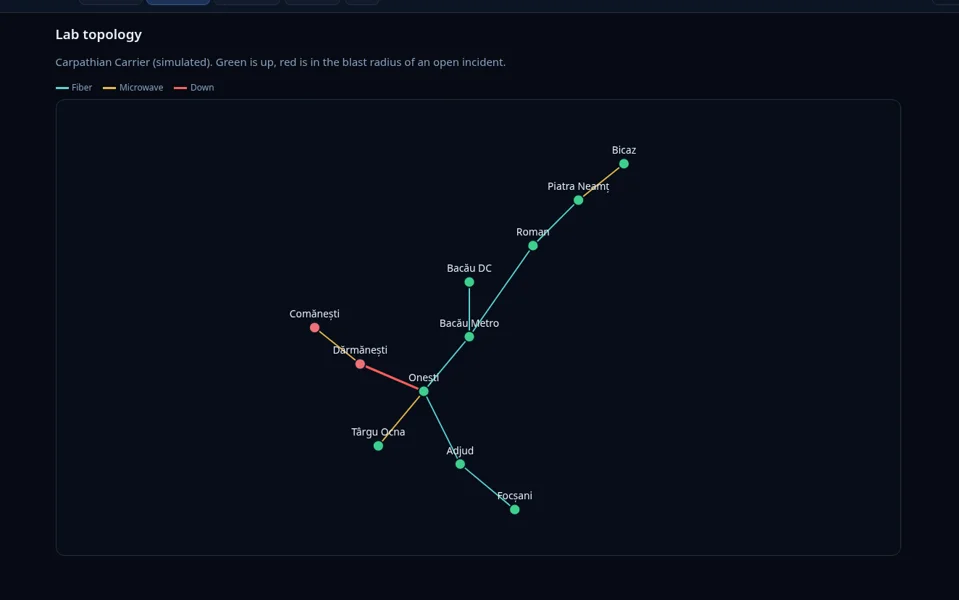
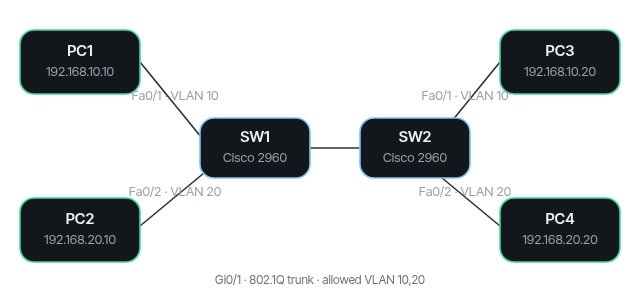
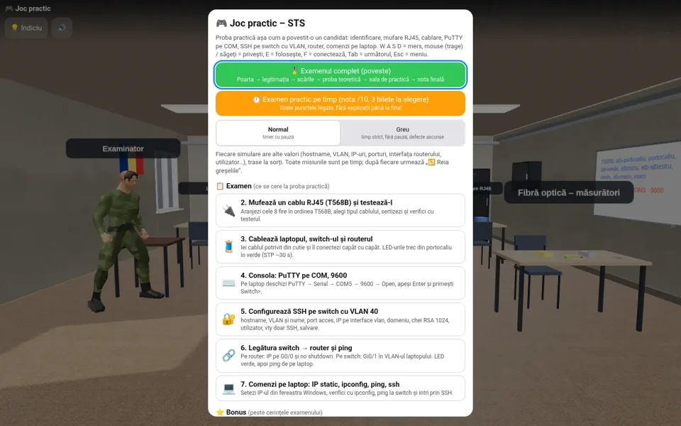
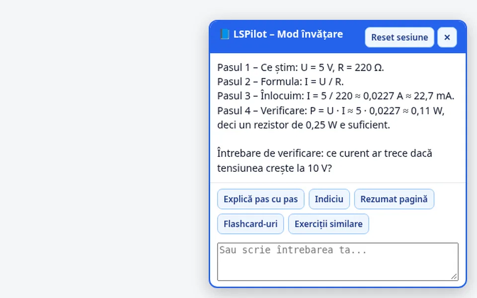
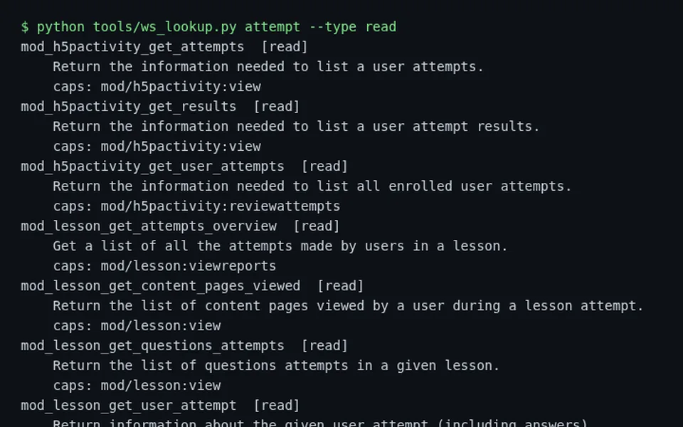
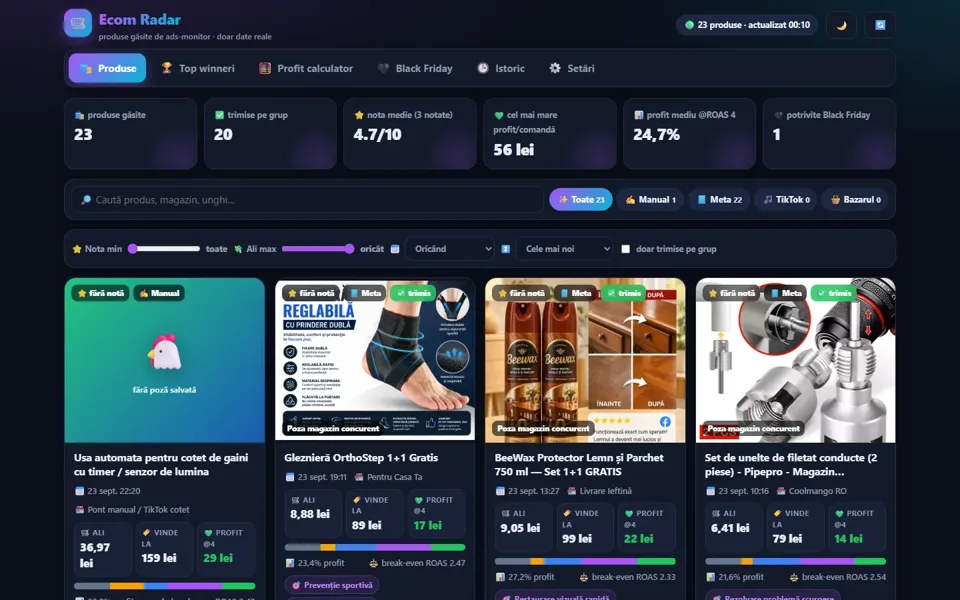
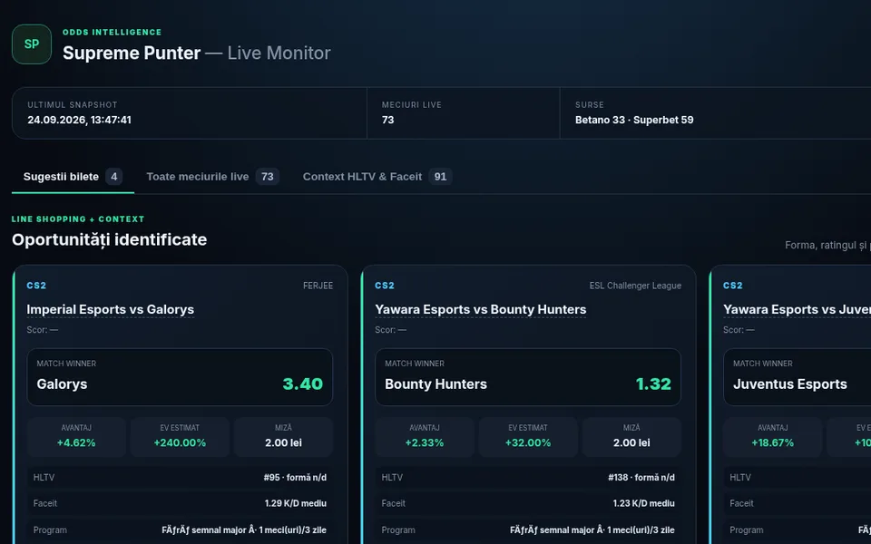
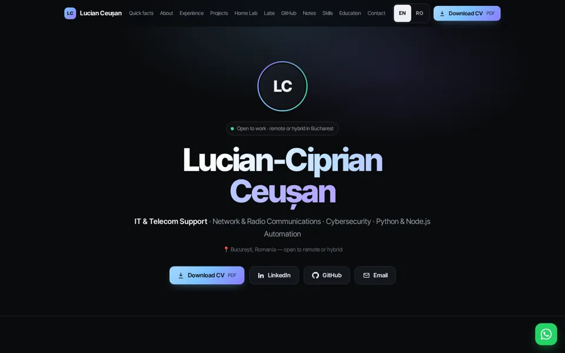

# Hi, I'm Lucian Ceușan 👋

**Telecom & network technician · Bucharest, Romania · open to remote / hybrid IT Support, NOC, Network Support and Junior SOC roles**

[English](#-about-me) · [Română](#-română)

## 🙋 About me

- 📡 I work at a Romanian state institution on **radio-relay and microwave links (Ceragon)**, mobile communications centres and digital switching equipment.
- 🛠️ Outside work I build tools in **Python** and **JavaScript** — from a NOC incident layer to a Moodle study assistant.
- 🎓 Currently learning: **CCNA**, **TryHackMe**.

## 🧰 Skills

         

## 🚀 Projects

| | Repository | What it is |
|---|---|---|
|  | [**rootfold**](https://github.com/LucianCeusanRo/rootfold) | Self-hosted NOC incident layer: one root-cause incident per outage, blast radius, re-check of children after recovery (Python, FastAPI) |
|  | [**ccna-packet-tracer-labs**](https://github.com/LucianCeusanRo/ccna-packet-tracer-labs) | Cisco Packet Tracer labs: VLAN + trunk, inter-VLAN routing, OSPF, standard & extended ACLs |
|  | [**sts-grila**](https://github.com/LucianCeusanRo/sts-grila) | Telecom & networking exam trainer (PWA): ~3,100 questions and a 3D practical lab (three.js) |
|  | [**lspilot**](https://github.com/LucianCeusanRo/lspilot) | Moodle study assistant (browser extension + Cloudflare Worker) that switches itself off during graded exams |
|  | [**moodle-kb**](https://github.com/LucianCeusanRo/moodle-kb) | Moodle 4.x/5.x knowledge base + map of 492 verified web-service functions |
|  | [**ecom-radar**](https://github.com/LucianCeusanRo/ecom-radar) | Product research pipeline: ad data → supplier match (Playwright + local vision model) → margins → Shopify drafts |
|  | [**betting-tips-dashboard**](https://github.com/LucianCeusanRo/betting-tips-dashboard) | Local odds line-shopping dashboard with capped ¼-Kelly stakes and a human-approval queue |
|  | [**lucian-ceusan-site**](https://github.com/LucianCeusanRo/lucian-ceusan-site) | Source of my bilingual portfolio site (static HTML/CSS/JS) |

Every repository has a bilingual README (English + Romanian) with a step-by-step tutorial.

## 🇷🇴 Română

<b>Click pentru versiunea în limba română</b>

Tehnician de telecomunicații și rețele, din **București** — deschis la roluri remote sau hybrid în suport IT, NOC, suport telecom / rețea și Junior SOC.

- 📡 Lucrez într-o instituție de stat din România, pe **legături radioreleu și microunde (Ceragon)**, centre mobile de comunicații și echipamente de comutație digitală.
- 🛠️ În afara serviciului construiesc unelte în Python și JavaScript.
- 🎓 Acum învăț: CCNA, TryHackMe.

**Proiecte:** [rootfold](https://github.com/LucianCeusanRo/rootfold) (incidente NOC) · [ccna-packet-tracer-labs](https://github.com/LucianCeusanRo/ccna-packet-tracer-labs) (laboratoare Cisco) · [sts-grila](https://github.com/LucianCeusanRo/sts-grila) (pregătire examene telecom, laborator 3D) · [lspilot](https://github.com/LucianCeusanRo/lspilot) (asistent de studiu Moodle) · [moodle-kb](https://github.com/LucianCeusanRo/moodle-kb) (documentație Moodle) · [ecom-radar](https://github.com/LucianCeusanRo/ecom-radar) (cercetare produse) · [betting-tips-dashboard](https://github.com/LucianCeusanRo/betting-tips-dashboard) (comparare cote) · [lucian-ceusan-site](https://github.com/LucianCeusanRo/lucian-ceusan-site) (portofoliu).

